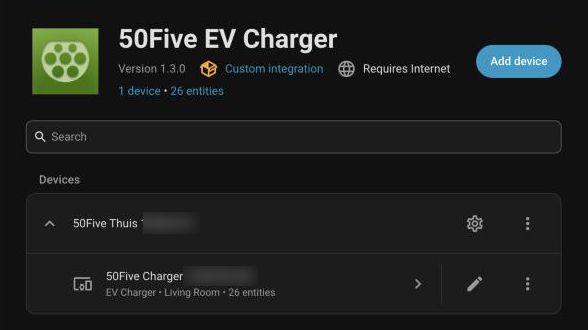
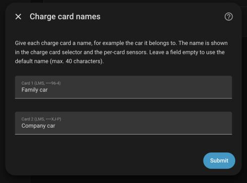
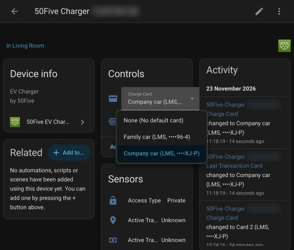
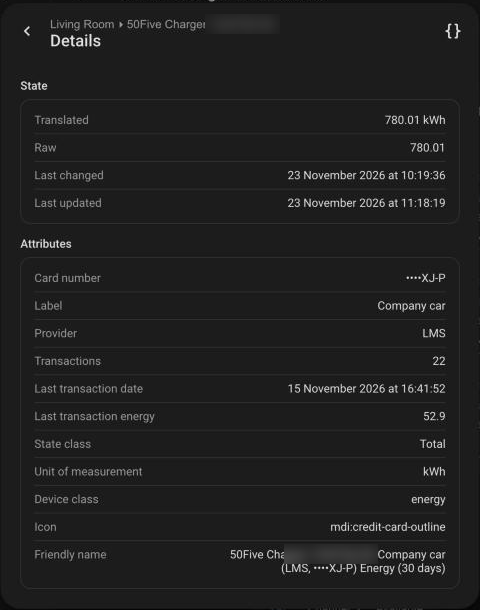

# Charge cards: names and energy per card

When several cars share one charger, each with its own charge card, the 50Five
integration can show which card started each session and how much energy each
card used. You can also give each card a name, such as the car it belongs to, so
it's easy to recognise.

This guide covers:

1. [Naming your charge cards](#1-name-your-charge-cards)
2. [Choosing the default card for the Charger switch](#2-choose-the-default-card)
3. [Seeing the energy used per card](#3-see-the-energy-used-per-card)
4. [Seeing which card charged last](#4-see-which-card-charged-last)
5. [Examples](#5-examples)
6. [Good to know](#good-to-know)

---

## 1. Name your charge cards

1. In Home Assistant, go to **Settings → Devices & services** and open
   **50Five EV Charger**.
2. Click the **cog icon** (Configure) next to your 50Five entry.

   

3. The **Charge card names** dialog shows one field per charge card on your
   50Five account. Each field is labelled with the card's default name, its
   provider and the last four characters of the card number, so you can tell
   the cards apart.
4. Enter a name for each card, for example the car it belongs to, then click
   **Submit**.

   

The new names show up right away. You don't need to restart or reload anything.

- To go back to the default name (`Card 1`, `Card 2`, …), clear the field and
  click **Submit**.
- Names can be up to 40 characters long.
- To change a name later, open **Configure** again. The fields show the current
  names.

## 2. Choose the default card

The **Charge Card** selector on the charger device shows your card names. The
selected card is used when you start charging with the **Charger** switch.



## 3. See the energy used per card

Every charge card gets its own sensor:

> **`<card name> (<provider>, ••••<last 4>)` Energy (30 days)**

It shows the total energy (kWh) charged with that card over the last 30 days.
Open the sensor and choose **⋮ → Details** to see more:



| Attribute | Meaning |
|-----------|---------|
| **Card number** | Masked card number (last four characters only) |
| **Label** | The name you gave the card (empty if you didn't name it) |
| **Provider** | The card provider |
| **Transactions** | Number of sessions with this card in the last 30 days |
| **Last transaction date** | Start of the most recent session with this card |
| **Last transaction energy** | Energy (kWh) of the most recent session with this card |

All the cards' sensors together add up to the **Total Energy (30 days)**
sensor, unless sessions were started with a card that isn't on your account
(see [Good to know](#good-to-know)).

## 4. See which card charged last

The **Last Transaction Card** sensor shows which card started the most recent
finished session, for example `Company car (LMS, ••••XJ-P)`. It's handy for
automations and notifications.

## 5. Examples

Replace the entity IDs below with your own. You can find them under
**Settings → Devices & services → Entities**, by searching for "Energy (30 days)"
or "Last Transaction Card". A card's entity ID is based on its default name when
the sensor was first created, for example
`sensor.50five_charger_1234567890_card_1_lms_96_4_energy_30_days`. Naming the
card doesn't change it.

### Dashboard: energy per car

```yaml
type: entities
title: Charging per car (last 30 days)
entities:
  - entity: sensor.50five_charger_1234567890_card_1_lms_96_4_energy_30_days
    name: Family car
  - entity: sensor.50five_charger_1234567890_card_2_lms_xj_p_energy_30_days
    name: Company car
  - entity: sensor.50five_charger_1234567890_last_transaction_card
    name: Last charged
```

### Automation: notify which car was charged

```yaml
alias: Notify when a charging session is finished
triggers:
  - trigger: state
    entity_id: sensor.50five_charger_1234567890_last_transaction_date
conditions:
  - condition: template
    value_template: "{{ trigger.from_state.state not in ['unknown', 'unavailable'] }}"
actions:
  - action: notify.notify
    data:
      title: Charging session finished
      message: >
        {{ states('sensor.50five_charger_1234567890_last_transaction_card') }} charged
        {{ states('sensor.50five_charger_1234567890_last_transaction_energy') }} kWh.
```

---

## Good to know

- **Card numbers stay private.** Home Assistant never shows the full card
  number, only the last four characters (`••••XJ-P`). The names you choose are
  stored only in your own Home Assistant.
- **Renaming doesn't break anything.** A new name only changes how the card is
  shown. Entity IDs stay the same, so dashboards, automations and history keep
  working.
- **Finished sessions only.** The card behind a session is known once the
  session shows up in the 50Five charging history. A session that is still
  running is counted after it ends. The history refreshes every 10 minutes, and
  straight after you start or stop charging from Home Assistant.
- **Rolling 30 days.** The per-card totals cover the last 30 days, the same as
  the other history sensors. Old sessions drop out as the window moves, so the
  value can go down.
- **Cards from other accounts.** If a session was started with a card that isn't
  on your 50Five account (for example a guest's card), **Last Transaction Card**
  shows `Other card (••••<last 4>)`. That energy isn't counted in any of your
  cards' sensors.
- **New or removed cards.** A card you add to your 50Five account gets its
  sensor automatically. A card you remove makes its sensor show as unavailable.

### Troubleshooting

| Problem | Solution |
|---------|----------|
| **Configure** says *"No charge cards were found on this 50Five account"* | Make sure the integration is loaded (not in an error state) and your 50Five account has at least one charge card, then try again. |
| A card's energy stays at 0 kWh | No sessions were started with that card in the last 30 days, or the newest session hasn't appeared in the 50Five history yet. Wait up to 10 minutes. |
| The name doesn't change in a dashboard | Dashboard cards with their own `name:` override the entity name. Remove `name:` or update it. |
